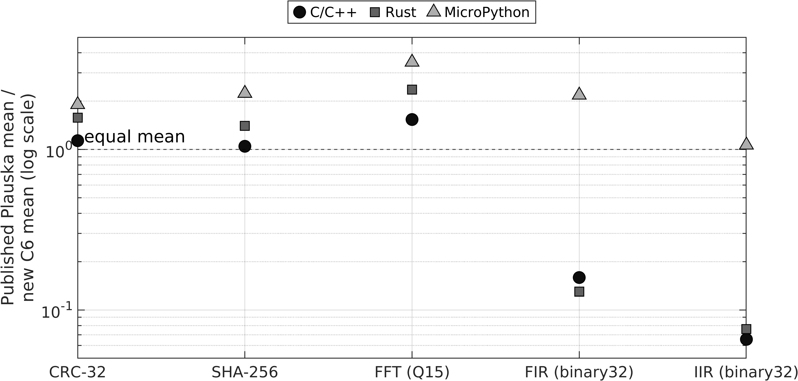
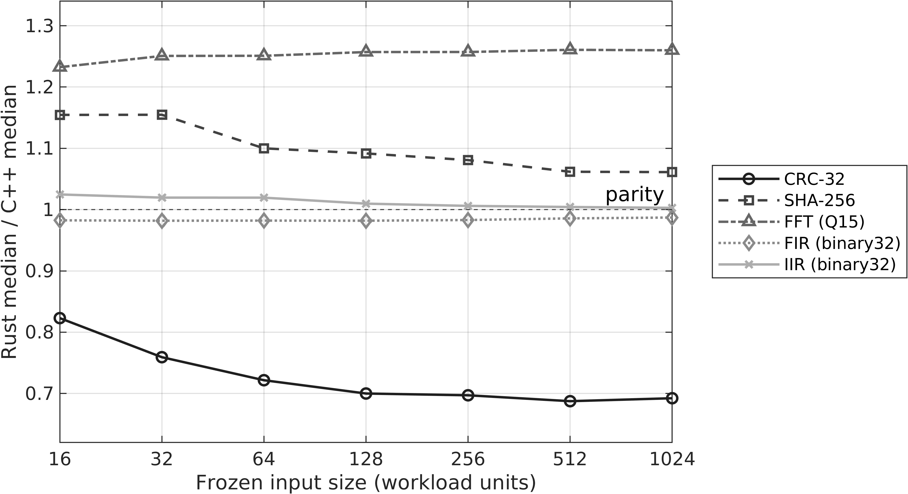

# ESP32 workload study: classic Xtensa and ESP32-C6

Research by **Izbassar Yesbol** · [ORCID 0009-0002-1737-7982](https://orcid.org/0009-0002-1737-7982) · 2026 · [Technical report (PDF)](paper/review-manuscript.pdf) · [Supplement (PDF)](paper/review-supplement.pdf)

I reproduced five embedded workloads on a physical ESP32-C6, then compared the results with published measurements on the classic ESP32. The comparison is useful for understanding where the workloads changed; it does not isolate the instruction set. The two platforms also differ in memory, peripherals, toolchains, runtimes, and experimental procedure.

This repository holds the protocols, measurements, build artifacts, disassemblies, analysis, and manuscript. The report is a **working technical report, not an externally peer-reviewed publication**. [Original software uses MIT and original data/documentation use CC BY 4.0](LICENSING.md), with explicit [third-party exceptions and notices](THIRD_PARTY_NOTICES.md). [Upstream permission and binary-dependency redistribution](references/original-study/REDISTRIBUTION_REVIEW.md) remain open before a public archive. The [reading ledger](literature/READING_LEDGER.md) is a discovery record, not a systematic literature review.

## What was measured

One ESP32-C6 revision 0.2 board ran CRC-32, SHA-256, Q15 FFT, binary32 FIR, and binary32 IIR in C/C++, Rust, and MicroPython. Mode A used a common correctness gate and timing boundary: eight input sizes and 100 accepted observations per size, giving **12,000 local observations**. Mode B recorded **9,600 additional observations** under declared native performance builds, a SHA peripheral path, and an audited Rust FFT transformation.

Published classic-ESP32 means from [Plauska, Liutkevičius, and Janavičiūtė (2023)](https://doi.org/10.3390/electronics12010143) are kept as historical aggregates. Their [source repository](https://github.com/ignasp/ProgLangComp_onESP32) was audited at [commit `c42dba0`](https://github.com/ignasp/ProgLangComp_onESP32/tree/c42dba0d41d547960b73e63b3d4e09917d61e171). I did not rerun their original board or treat their published means as local samples.

## What the results show

At the largest shared input, native C6 CRC-32, SHA-256, and FFT means fall below the published classic-ESP32 means; FIR and IIR means go the other way. Within the C6 experiment, Rust is faster than C++ for CRC-32, slower for SHA-256 and FFT, and close to C++ for FIR and IIR. Those observations depend on the workload and the complete software and hardware setup.

The exact C6 FIR/IIR binaries call software floating-point routines, while matched reconstructed Xtensa binaries emit floating-point instructions. This is a plausible contributor to the historical contrast, not a measured attribution of that contrast. The Rust FFT transformation lowered its median by 22.7% relative to the safe performance build but changed the whole kernel. The C6 SHA peripheral path was 8.70× faster than Mode A software; that is a peripheral result.



*Figure 1. Ratios compare two different experiments. A value above one means a lower local C6 mean.*



*Figure 2. Within-board Mode A ratios. Parity is not an equivalence test.*

## Read the study

- [Manuscript](paper/manuscript.tex), [PDF](paper/review-manuscript.pdf), and [supplement](paper/review-supplement.pdf)
- [Methods](METHODOLOGY.md), [research questions](RESEARCH_QUESTIONS.md), and [reproduction contract](REPRODUCIBILITY.md)
- [Related-work comparison](literature/RELATED_WORK_DEEP_REVIEW.md) and [September 2026 positioning update](literature/2026-09-positioning-update.md)
- [Processed results](data/processed/), including the transcribed [historical aggregates](data/processed/plauska_crc32_historical_summary.csv), and [raw acquisition bundles](data/raw/)
- [Exact and reconstructed code artifacts](artifacts/assembly/) and [figure manifest](paper/PUBLICATION_FIGURE_MANIFEST.csv)

The manuscript's claim boundaries matter: only the C6 was newly timed; reconstructed Xtensa objects were not executed; one accepted Rust CRC binary was not retained and is labelled as a reconstruction. The internal files in `paper/reviews/` are quality-control notes, **not external peer reviews**.

## Reproduce the paper

The [paper guide](paper/README.md) gives the build order and prerequisites. The shortest validation path from the repository root is:

```text
python paper/tools/build_final_synthesis.py
python paper/tools/build_repeatability_summary.py
python paper/tools/build_publication_assets.py
python paper/tools/validate_manuscript.py
python paper/tools/validate_publication.py
powershell -File paper/tools/build_review_pdf.ps1
```

Figure regeneration additionally requires MATLAB R2024b; PDF compilation uses Tectonic. The figures committed here are checked against [recorded hashes](paper/PUBLICATION_FIGURE_MANIFEST.csv). Raw observations and historical baselines are never rewritten to make a figure or claim pass.

## Next experiments

Another ESP32 board could strengthen the comparison. It would need its own versioned protocol, build records, and raw acquisition cohort. Its observations would be reported alongside this C6 study rather than folded into the existing 21,600 rows.
