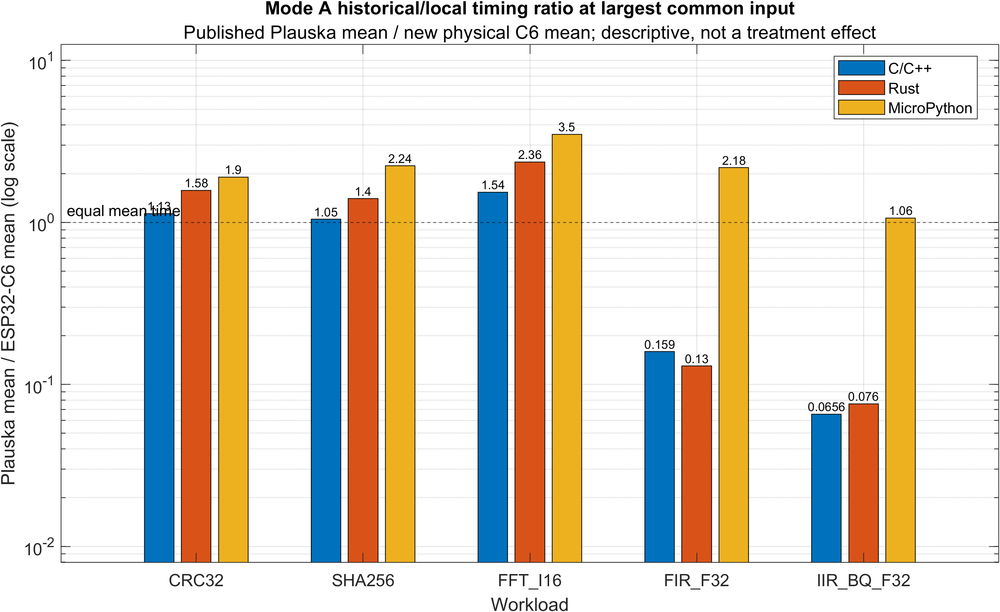
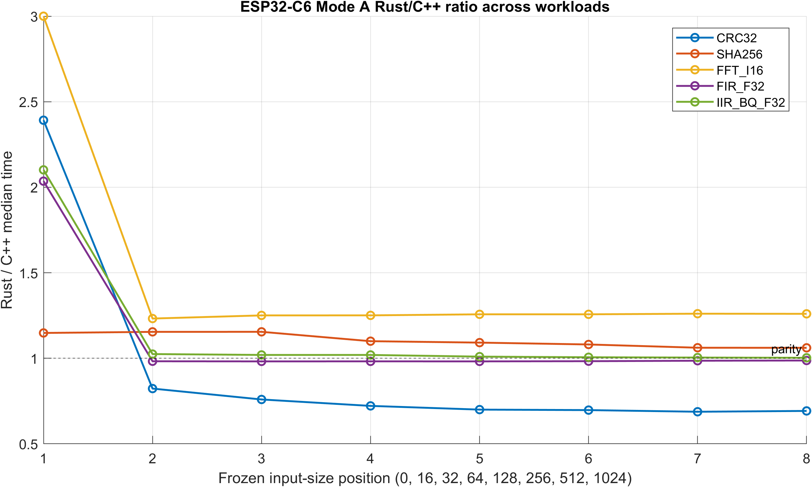
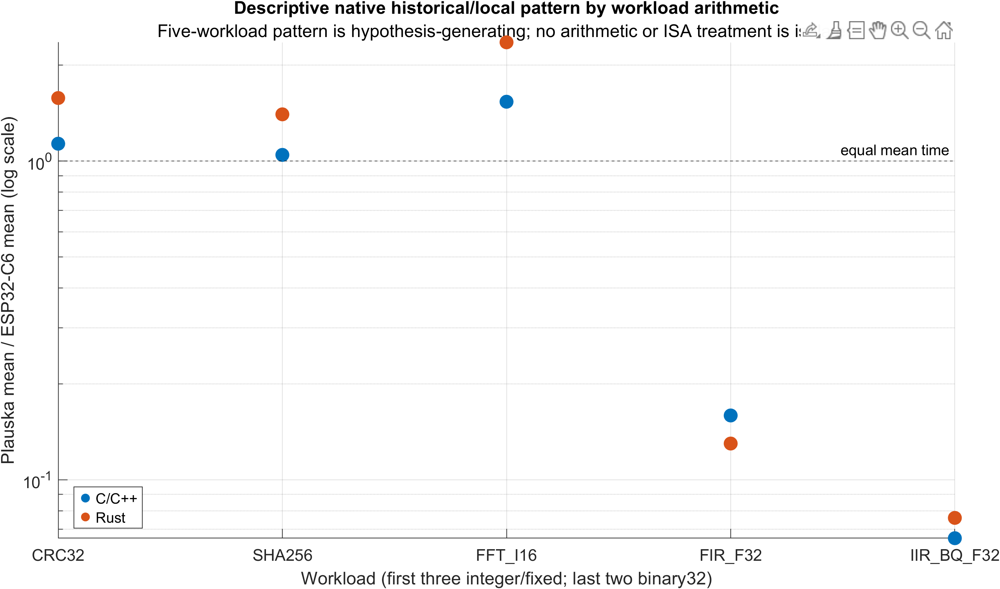
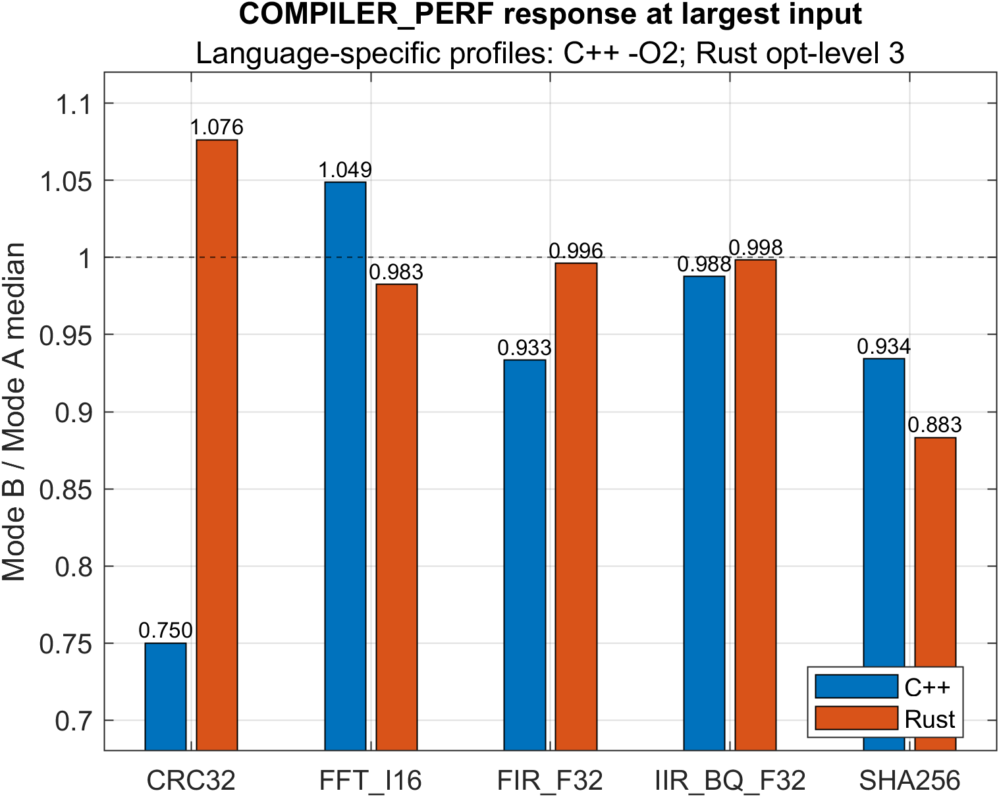
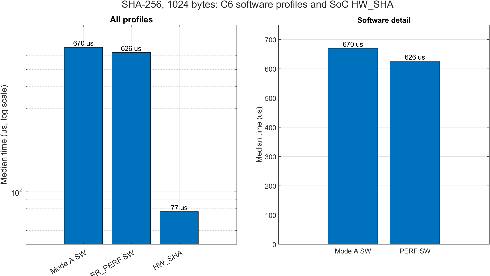
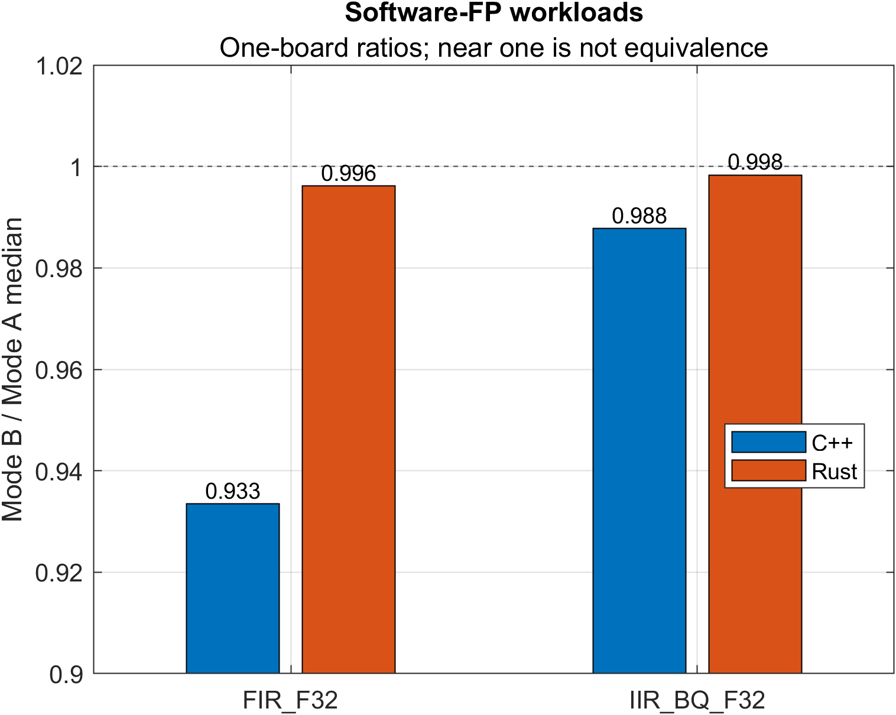

# Abstract

Published classic-ESP32 benchmarks invite comparison with the newer ESP32-C6, but a historical-to-new comparison changes the processor, memory system, software generations, and measurement details simultaneously. We therefore present a reproduction-oriented ESP32-C6 extension of Plauska et al., not a controlled Xtensa-versus-RISC-V experiment. CRC-32, SHA-256, Q15 FFT, binary32 FIR, and binary32 IIR were implemented in C/C++, Rust, and MicroPython under common correctness and timing rules. One physical ESP32-C6 produced 12,000 Mode A repeated observations; 9,600 additional Mode B observations cover language-specific performance builds, the C6 SHA peripheral, and an audited Rust FFT transformation. Published classic-ESP32 aggregates remain separate historical evidence. Exact measured C6 binaries and provenance-preserving matched Xtensa/RV32IMAC reconstructions provide static code-generation evidence, not historical execution measurements.

Results are workload dependent. At the largest input, local native CRC-32, SHA-256, and FFT means are lower than the published values, whereas local FIR and IIR means are substantially higher. Within the measured C6, C++ and Rust ordering crosses parity. Exact C6 FIR/IIR kernels call software-floating-point helpers; matched reconstructed Xtensa objects emit floating-point instructions, and performance compilation leaves the C6 helper path intact. This contrast is consistent with software floating point being a major contributor to the historical/local FIR/IIR direction, but its contribution is not quantitatively isolated. The audited unchecked Rust FFT transformation removes panic machinery, changes the whole generated kernel, and is 22.7% faster than the safe performance build at 1024 points; it is not an isolated bounds-check cost. Hardware SHA is 8.70× faster than Mode A software at 1024 bytes and is explicitly a SoC-peripheral result. The evidence supports a single-board C6 case study with descriptive historical context and workload-specific mechanism hypotheses, not ISA causality or population-level hardware generalization.

# 1. Introduction

The classic ESP32 integrates Xtensa LX6 processors, whereas the ESP32-C6 uses an Espressif RISC-V high-performance core configured as RV32IMAC [@espressifESP32Datasheet; @espressifESP32C6Datasheet]. Comparing published results from the former with new measurements from the latter is scientifically useful but not a controlled architecture experiment. ISA, core implementation, caches, flash, board, compiler backend, SDK, runtime, and protocol can all change. In this paper, *platform* denotes that complete measured context; *ISA* denotes the instruction-set contract; *target* denotes a compiler configuration; and *generated code* denotes a particular build artifact.

Plauska et al. measured C/C++, Rust, MicroPython, and TinyGo on a classic ESP32 using CRC-32, SHA-256, FFT, FIR, and IIR [@plauska2023performance]. Their paper and repository provide a directly relevant historical anchor, but several inputs, launcher behaviors, warm-ups, and MicroPython boundaries are inconsistent or incompletely recoverable. We reconstruct the comparable contract on ESP32-C6 and describe all comparisons to Plauska as historical and descriptive. Only the C6 was newly measured. The Xtensa objects in this study are matched reconstructions: they reveal how pinned toolchains lower matched source, but they neither reproduce Plauska's binaries nor supply physical Xtensa timing.

The contribution is a provenance-preserving, correctness-gated reconstruction and ESP32-C6 extension of Plauska's five-workload suite. It combines three-language physical C6 timing, exact measured native artifact preservation except one disclosed ELF, matched reconstructed Xtensa/RV32IMAC code analysis, separated fair and optimized modes, and explicit MEASURED/PUBLISHED/RECONSTRUCTED/DOCUMENTED/INFERRED evidence labels. The novelty lies in that integrated evidence chain, not in being the first ESP32 language benchmark, ESP32-C6 evaluation, or Xtensa/RISC-V comparison.

# 2. Background

## 2.1 Hardware and target context

Classic ESP32 uses configurable Xtensa LX6 processors. Vendor records describe the implemented memory, cache, floating-point, and DSP-related facilities [@espressifESP32Datasheet; @espressifESP32TRM]. A generic Xtensa ISA summary describes possible instruction forms, not a specific chip configuration [@cadenceXtensaISASummary]. ESP32 register-window behavior is relevant architectural context [@lehniger2023throughwindow; @lehniger2025shadowstacks], but it is not used here to infer kernel timing.

The ESP32-C6 record identifies one high-performance RV32IMAC core plus a low-power core [@espressifESP32C6Datasheet; @espressifESP32C6TRM]. `I`, `M`, `A`, and `C` provide integer, multiplication/division, atomic, and compressed-instruction facilities [@riscvUnprivV22; @riscvCompressedV20]. The selected target has no standard `F` extension. Register roles follow the pinned toolchain ABI [@riscvPsABI10]. These documented facts constrain plausible lowering, but documentation alone never proves which instructions a compiler emitted; preserved binaries supply that evidence.

## 2.2 Language execution models

C++ and Rust compile to native RV32IMAC code but differ in sources, front ends, libraries, and safety semantics. MicroPython interprets object-oriented bytecode and incurs allocation and numeric-object costs; its documentation explicitly discusses allocation avoidance and native emitters [@micropythonSpeedV128]. Prior ESP32 studies likewise report native/interpreted differences [@ionescu2020micropythonc; @tan2025scripting]. Thus MicroPython's historical/local result includes runtime-generation and implementation changes, not an ISA contrast.

# 3. Related Work

Plauska et al. provide the direct baseline [@plauska2023performance]. Ionescu and Enescu compare C and MicroPython on ESP32/STM32 [@ionescu2020micropythonc], and Tan et al. broaden ESP32 scripting-runtime comparisons [@tan2025scripting]. Recent ESP32-C3 work further shows that runtime and event models matter on Espressif RISC-V hardware [@tan2026eventdriven]. These studies establish precedent for language benchmarking; none substitutes for the present audited C6 reconstruction and artifact lineage.

Cross-platform work illustrates why heterogeneous boards do not identify ISA effects. Ariel OS evaluates embedded Rust across Xtensa, RISC-V, and Arm devices [@frank2025ariel]; Femto-Containers studies portable isolation across heterogeneous microcontrollers [@zandberg2022femtocontainers]; and Hubacz and Trybus include Espressif Xtensa and RISC-V devices in an alignment study [@hubacz2022alignment]. Molano Rodríguez includes classic ESP32 and ESP32-C6 in a broader evaluation, but different implementations and incomplete paired provenance limit direct comparison [@molano2025riscvfpga]. Our narrower distinction is the combination of an audited historical contract, common C6 correctness/timing rules, exact measured C6 artifacts, labelled matched reconstruction, and separate optimization profiles.

Energy and modern runtimes remain adjacent. Lima studies cryptographic configuration and module-rail measurement on C6 [@lima2025esp32c6signatures], while Has et al. examine WebAssembly on constrained devices including C6 [@has2025wasmiot]. Neither is used to infer energy or performance for our kernels.

# 4. Research Questions

**RQ1.** What low-level generated-code differences are observed between exact measured ESP32-C6 RV32IMAC artifacts and matched reconstructed classic-ESP32 Xtensa artifacts for the frozen workloads, and which documented target mechanisms are consistent with the new C6 observations and published historical direction?

**RQ2.** Under the reconstructed common protocol, how do C/C++, Rust, and MicroPython compare within the measured ESP32-C6, and how do those local results differ descriptively from Plauska's published classic-ESP32 aggregates?

Mode B asks two exploratory platform questions: how each native language's own performance-oriented profile changes observed C6 timing, and what the dedicated C6 SHA peripheral changes relative to the frozen software implementation. Neither question treats optimizer levels as equivalent across languages or hardware SHA as an ISA feature.

# 5. Methodology

## 5.1 Design and evidence classes

This is a physical single-board ESP32-C6 case study plus a historical cross-study comparison and static matched-code analysis. We separate: **MEASURED** C6 observations; **PUBLISHED** Plauska aggregates; **MEASURED-BUILD** exact C6 code; **RECONSTRUCTED** matched Xtensa/RV32IMAC code; **DOCUMENTED** vendor/ISA facts; and **INFERRED** mechanisms. Published aggregates are never expanded into synthetic samples. Reconstructed objects are not Plauska binaries and were not executed.

The historical source is DOI 10.3390/electronics12010143 and pinned source commit `c42dba0d41d547960b73e63b3d4e09917d61e171`. Audit records classify recovered properties as exact, equivalent, deviation, or unknown. Known inconsistencies include historical warm-up descriptions, MicroPython slicing/preparation, launcher iteration behavior, and validation coverage. These remain limitations rather than a separate experimental mode.

## 5.2 Hardware and controls

Measurements used one ESP32-C6 revision 0.2 module on an ESP32-C6 Relay X1 carrier with 4 MB DIO flash at 80 MHz. The high-performance CPU was fixed and read back at 160 MHz. Dynamic frequency scaling, sleep, Wi-Fi, BLE, and IEEE 802.15.4 were disabled. Supply, ambient conditions, between-day variability, and board-unit variability were not experimentally controlled or estimated. The available KWS-V20 meter cannot isolate the module or chip rail, so no energy result is reported.

Native timing used `esp_timer_get_time()`; MicroPython used the frozen `time.ticks_us()` equivalent. The timer-resolution pilot measured timer behavior and selected repeated-kernel batches for short calls. Every raw record retains batch count, total batch duration, and normalized per-call time. Serial output, allocation, input slicing/copying, table construction, garbage-collection preparation, validation, and cleanup are outside the timed kernel. Zero-length and small-size observations primarily expose fixed/timer overhead and are not interpreted as algorithmic throughput.

## 5.3 Mode A

Mode A is a fair, reproduction-oriented reconstruction. Each language uses the same recoverable algorithm, canonical input, eight historical sizes (0, 16, 32, 64, 128, 256, 512, and 1024 workload units), correctness requirements, one unmeasured warm-up, and 100 accepted observations per size. CRC-32 is CRC-32/ISO-HDLC; SHA-256 is the frozen software implementation; FFT preserves the recovered Q15 complex representation and scaling; FIR and IIR preserve binary32 coefficients, operation order, initial state, and tolerances. Host/MATLAB oracles pass before timing. Architecture-specific optimization and the C6 SHA accelerator are prohibited.

The resulting 12,000 observations are five workloads × three languages × eight sizes × 100 sequential repetitions. They characterize within-acquisition behavior on one board. They are not 100 independent runs, devices, or population samples.

## 5.4 Mode B

Mode B preserves workload contracts while declaring profile changes. C++ uses ESP-IDF v5.5.5's performance configuration; preserved commands show GCC 14.2.0 `-O2`. Rust uses rustc/cargo 1.97.1 release opt-level 3 with `esp-idf-sys` 0.37.2. These are distinct native toolchain policies grouped for presentation, not equivalent optimizer treatments.

`HW_SHA` invokes the ESP-IDF one-shot `mbedtls_sha256` path. Every timed invocation includes API setup/finalization, hardware arbitration, and the internal DMA/HAL path; input preparation and result validation remain outside. Exact code calls `esp_sha_acquire_hardware`, `esp_sha_dma`, and SHA HAL routines. With radios disabled and no competing benchmark task, the result represents the tested C6 SoC/software path, not a bare compression round or RISC-V CPU acceleration.

`RUST_UNCHECKED` was permitted only after exact safe FFT code retained five bounds-panic references and frozen preconditions proved indexes valid for zero or power-of-two sizes through 1024. The transformation replaces checked indexing, removes panic machinery, and induces broader code-layout/control changes. It therefore measures the complete audited transformation, not the isolated latency of bounds checks. CRC IRAM was rejected because no prior fetch/cache observation supplied an identifiable hypothesis. Mode B contains 9,600 observations.

## 5.5 Toolchains, acquisition, and descriptive statistics

C++ used ESP-IDF v5.5.5/GCC 14.2.0. Rust used rustc/cargo 1.97.1 and `esp-idf-sys` 0.37.2. MicroPython used the official ESP32_GENERIC_C6 v1.28.0 build dated 2026-04-06. Run bundles record target, versions, flags/configuration, vectors, timer, batch, board, flash, radio controls, correctness, and artifact hashes. Exact measured native artifacts are retained except the accepted Mode A Rust CRC ELF; that case uses a clearly labelled pinned-source reconstruction.

Processing validates row counts, correctness, unique size/iteration keys, metadata, and reconstruction of normalized time from batch duration/count. We report count, mean, median, sample SD, and for largest-input repeatability the 5th, 25th, 75th, and 95th percentiles, IQR, range, and coefficient of variation. These summarize one captured sequence; no confidence interval is presented as board-population uncertainty. Cross-study ratios are published historical mean/local mean because only published aggregates are available. Within-C6 language and Mode B ratios use medians. A ratio near one is not an equivalence test, and low-single-percent differences are described as observed changes unless independent sessions exist.

## 5.6 Static binary analysis

Exact C6 ELF disassemblies provide symbol size, static instruction rows, loads, stores, branches, calls, stack frames, helper references, and panic references. Symbol boundaries and extraction rules are preserved with each workload report. Matched C++ source is compiled for Xtensa and RV32IMAC with pinned invocations. Counts are static properties, not dynamic instructions, path frequencies, cycles, stalls, or cache misses.

# 6. Results

## 6.1 Mode A overview

Figure 1 shows published Plauska mean divided by the new physical C6 mean at the largest common input. Values above one indicate a lower local mean; values below one indicate a lower published mean. This cross-study ratio is descriptive and cannot be read as an ISA or platform treatment effect.

For C++, ratios are 1.134 (CRC), 1.046 (SHA), 1.536 (FFT), 0.159 (FIR), and 0.066 (IIR). Rust ratios are 1.578, 1.403, 2.360, 0.130, and 0.076. MicroPython ratios are 1.904, 2.236, 3.498, 2.181, and 1.064. The direction reversal in native binary32 workloads is a pattern requiring mechanism discussion, not proof that arithmetic class or ISA caused it.

Largest-input within-acquisition variability is small for most native groups, but it cannot establish between-run or between-board uncertainty. For example, CRC C++ has mean 103.69 us and SD 0.884 us, FFT C++ mean 1185.568 us and SD 0.050 us, and Rust IIR mean 3277.49 us and SD 2.525 us. Complete robust summaries and batch counts are in `tables/measurement_repeatability.csv`.

## 6.2 Workload and language observations

CRC-32 C6 medians at 1024 bytes are 104 us for C++ and 72 us for Rust (Rust/C++ 0.692). Exact C++ and reconstructed Rust loops differ in source form, addressing, and termination; because the accepted Rust ELF is missing, the Rust static result is reconstruction rather than exact measured-build evidence. C++ performance configuration yields 78 us, whereas the Rust performance build yields 77.5 us. Relative to its Mode A value, the latter is a 7.6% observed slowdown in this acquisition; it is not a language-wide optimizer conclusion.

SHA-256 medians are 670 us for C++ and 711 us for Rust (1.061). Matched Xtensa code uses `src` rotate idioms while RV32IMAC uses shift/combination sequences; exact Rust contains more control/storage structure than C++. Performance profiles yield 626 and 628 us. The close optimized values describe this board/build pair without establishing equivalence.

FFT medians are 1185.563 us for C++ and 1493.750 us for safe Rust (1.260). Exact and matched kernels use scalar fixed-point multiply/shift sequences; no matched Xtensa DSP/MAC or zero-overhead-loop instruction was observed. Safe Rust retains five panic references and a larger control structure. C++ performance configuration is 1243.438 us, an observed 4.9% regression; safe Rust is 1467.688 us, only 1.8% below Mode A and too small to generalize beyond the captured run.

FIR medians are 188774 us for C++ and 186340 us for Rust (0.987); IIR medians are 3268 and 3277.5 us (1.003). These are near-parity observations: no strong C++/Rust ranking is supported. Exact C6 FIR contains two `__mulsf3` and two `__addsf3` static call sites; IIR contains five `__mulsf3`, two `__addsf3`, and two `__subsf3` sites. Matched Xtensa FIR emits `madd.s`; matched IIR emits `mul.s`, `madd.s`, and `msub.s`. These are emitted-code observations, not timings of the reconstructed objects.

Figure 2 shows Rust/C++ ratios across sizes. Actual units differ by workload, so the shared x-axis represents the common frozen size sequence rather than interchangeable computational work.

## 6.3 Mode B observations

Figure 4 shows each language-specific performance profile relative to its own Mode A median. C++ CRC improves 25.0% in time ratio; C++ SHA and FIR improve about 6.6–6.7%; C++ FFT regresses 4.9%. Rust SHA improves 11.7%; Rust CRC regresses 7.6%. Rust FFT (1.8%), FIR (0.4%), and IIR (0.2%), plus C++ IIR (1.2%), are small observed differences for one acquisition and do not support general performance rankings.

The one-shot HW_SHA profile yields 77 us at 1024 bytes, 8.70× faster than C++ Mode A software and 8.13× faster than C++ performance-profile software. Figure 5 gives a log overview and a software-only detail panel so the modest compiler change and large peripheral effect are both visible. The result includes one-shot API setup/finalization, arbitration, DMA, and HAL work within the timed call.

The safe Rust performance FFT kernel has 125 static instructions, 398 bytes, 18 branches, five calls, and five panic references. The audited unchecked kernel has 83 instructions, 246 bytes, eight branches, no calls, and no panic references, and its 1024-point median is 1134.250 us. It is 22.7% faster than safe performance-profile Rust. Because checked-index removal also changes layout, control, register allocation, and other compiler-visible structure, this is a whole-transformation result, not an isolated bounds-check price.

Performance profiles retain the C6 FIR/IIR software-FP helpers. C++ FIR shows a 6.7% lower time ratio, while Rust FIR and both IIR values remain near one. Figure 6 deliberately labels these as descriptive and must not be read as an equivalence test.

# 7. Discussion

## 7.1 Answers to the research questions

RQ1 yields target-specific generated-code contrasts rather than an architecture treatment effect. CRC exposes loop/address formation; SHA exposes rotate lowering; Q15 FFT exposes scalar multiply/shift and safe-control structure; and FIR/IIR expose hardware-instruction versus software-helper lowering. These observations show that matched workloads can present different compiler-visible mechanisms on the two targets. They do not determine how much those mechanisms contributed to Plauska's timings.

RQ2 has no uniform direction. Local C6 native CRC/SHA/FFT means are below published means, while local FIR/IIR means are above them. Within C6, Rust/C++ ordering varies, with FIR/IIR near parity. MicroPython remains 22–890× C++ locally while its local means are below published means for all five workloads. Interpreter generation, object behavior, SDK, and source differences prevent an architectural reading.

## 7.2 Floating-point mechanism hypothesis

**OBSERVED:** exact measured C6 FIR/IIR binaries call software-FP helpers; matched reconstructed Xtensa artifacts emit floating-point operations; performance profiles retain C6 helpers; and historical/native timing points in the corresponding direction. **DOCUMENTED:** the selected C6 target is RV32IMAC without standard `F`, and classic ESP32 documentation supports its configured floating-point facility. **INFERRED:** these distinct execution strategies are consistent with software floating point being a major contributor to the historical/local FIR/IIR gap. IIR's loop-carried state constrains cross-sample reordering and makes a dependency-chain explanation plausible. Neither the helper contribution nor a pure FP-unit effect is quantified because historical binaries and matched physical controls are unavailable.

## 7.3 What Mode B adds

Mode B reinforces interaction rather than a uniform optimization story. Native performance profiles help, harm, or barely change different kernels. Near-one observations are not claimed as improvements. The FFT transformation demonstrates that an audited source-level safety change can induce a much smaller generated kernel and a substantial local timing change, without isolating one machine-level cause. Hardware SHA demonstrates a much larger full-SoC opportunity than compiler profiles while answering a different question from CPU software.

# 8. Threats to Validity

**Identification and historical validity.** Only ESP32-C6 was newly measured. Classic-ESP32 timing is published historical evidence; reconstructed Xtensa objects are contemporary static artifacts, not Plauska binaries. This is not a matched modern-toolchain two-board experiment. Equal nominal 160 MHz does not match microarchitecture or establish cycles. Compiler, SDK, runtime, board, memory, and protocol alternatives remain viable.

**Sampling validity.** One physical C6 and one acquisition sequence per accepted group do not estimate board, session, day, supply, or ambient variation. One hundred repetitions characterize the captured sequence, not independent hardware replication. Timer quantization/batching is retained in raw evidence. Small ratios are not equivalence or significance results. A C++ CRC watchdog diagnostic occurred between timed samples; all records remained unique/correct, but it documents scheduler activity outside the kernel interval.

**Construct validity.** Elapsed kernel time does not measure IPC, dynamic instructions, cache misses, energy, memory pressure, or application throughput. Static counts do not measure executed paths. Zero-length values emphasize fixed overhead. The KWS-V20 cannot isolate chip energy.

**Generated-code validity.** Matched builds control source semantics and declared policy but retain backend differences and were not executed. The accepted Rust CRC ELF was not retained. Safe/unchecked FFT changes the complete generated structure. Software-helper references and recurrence structure support hypotheses, not a decomposition of historical latency.

**External validity.** One board and five compact kernels do not represent all Espressif devices, RISC-V/Xtensa implementations, toolchains, languages, or applications. Binary32 FIR/IIR deliberately expose a target without standard hardware FP.

# 9. Reproducibility

The frozen experimental anchor is commit `933363b342ac960c0d364b4c6379b1ac884dec9f`. Analysis starts from `data/processed/`, verifies `paper/tables/experimental_inventory.csv`, and runs the workload processors, `matlab/run_mode_a_cross_workload_analysis.m`, and `matlab/run_mode_b_analysis.m` in MATLAB R2024b. `paper/FIGURE_MANIFEST.csv` maps each main figure to PNG source/hash; corresponding FIG/PDF outputs remain under `artifacts/matlab/`. `paper/tables/measurement_repeatability.csv` is generated by `paper/tools/build_repeatability_summary.py`.

Firmware reconstruction uses ESP-IDF v5.5.5/GCC 14.2.0, rustc/cargo 1.97.1 with `esp-idf-sys` 0.37.2, and MicroPython ESP32_GENERIC_C6 v1.28.0 (2026-04-06 build). Protocols and vectors are under `benchmarks/historical/<workload>/`; Mode B is under `benchmarks/optimized/`; exact builds/disassemblies are under `artifacts/builds/` and `artifacts/assembly/`. Raw bundles preserve total time, batch, normalized time, metadata, and rejected/diagnostic evidence. A rerun must create a new bundle rather than overwrite accepted evidence. The distributed workload manifests remain authoritative; the missing accepted Rust CRC ELF cannot be recovered without a new experiment.

# 10. Future Work

A matched physical classic-ESP32 rerun with contemporary toolchains would strengthen platform-generation comparison, though it still would not isolate ISA without further controls. Multiple boards, sessions, randomized profile order, supply/ambient logging, and dynamic counters/traces would support small-effect and mechanism claims. Targeted software-FP controls could quantify helper/dependency costs; surgical FFT variants could distinguish check removal from induced layout changes. Precise module/chip-rail instrumentation is required for energy. Additional languages and runtimes, including WebAssembly, Zig, and mruby, remain separate future studies [@wallentowitz2022wasm; @moron2023wasmjit].

# 11. Conclusion

This reproduction-oriented ESP32-C6 extension contributes a correctness-gated physical C6 dataset, a separated optimization campaign, preserved exact artifacts, and labelled matched Xtensa/RV32IMAC code-generation evidence. It does not constitute a controlled Xtensa-versus-RISC-V performance experiment. Across the five tested workloads, historical/local direction and within-C6 language ordering vary. Exact C6 FIR/IIR software helpers versus reconstructed Xtensa floating instructions provide the strongest emitted-code contrast and a plausible, unquantified explanation for the binary32 direction. The Rust FFT transformation and C6 SHA peripheral demonstrate distinct source-safety and SoC-capability effects. The supported conclusion is narrow: on this measured C6 and these frozen implementations, performance and generated structure depend on workload, language implementation, compiler profile, and platform facility; published classic-ESP32 values provide descriptive context rather than causal attribution.

# References

References are resolved from `paper/references.bib`; cited records retain their verified provenance.
